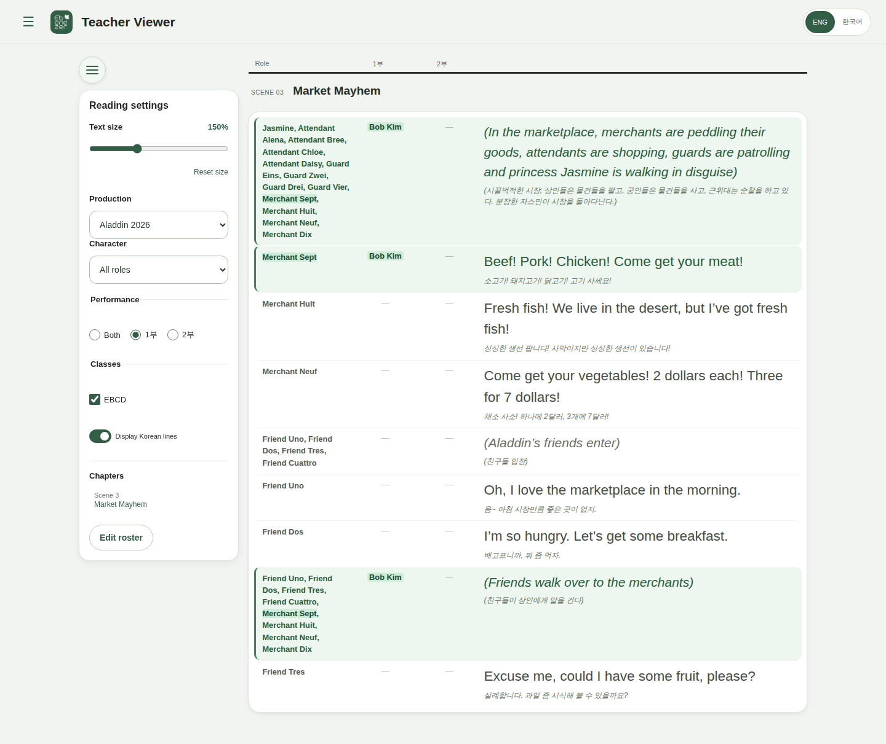

# Script Reader

[Open the live reader](https://ebenezer-script-reader.pages.dev/p/aladdin)

A mobile-friendly rehearsal reader with character selection, context controls, bilingual display, YouTube embeds, and Print / Save PDF. Hosted reading requires no student login; local CSV import is also available. Google-authenticated administration is at `/admin`.



Teacher Viewer with fictional casting: **Bob Kim · EBCD**, playing Merchant Sept in 1부. Staff viewing and casting tools require approved access.

Hosted `/` opens the main production. CSV import is at `/import`; the offline HTML demo remains available.

## Develop locally

Requires Node.js 22.12+.

```sh
npm ci
npm run dev
```

## Documentation

- [Development, architecture, print, and releases](docs/development.md)
- [Hosting, publishing, and recovery](docs/hosted-delivery.md)
- [CSV preparation and character tagging](docs/csv-tagging-guide.md)
- [Release notes](CHANGELOG.md)

Approved staff can manage productions and choose the student homepage at `/admin/scripts`; song links are at `/admin/songs`, and account status and navigation are at `/admin`. The private Teacher Viewer is at `/admin/viewer`; student casting, JSON backups and master-only bulk tools are at `/admin/roster`. See [browser publication](docs/hosted-delivery.md#manage-productions-in-the-browser).
